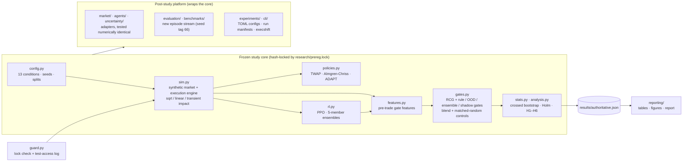
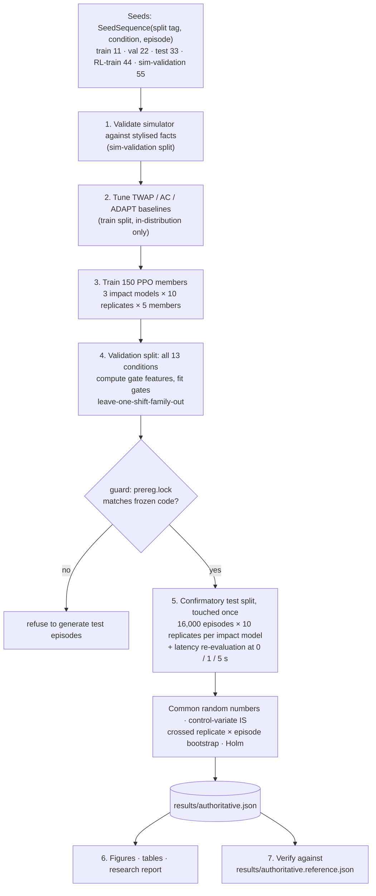
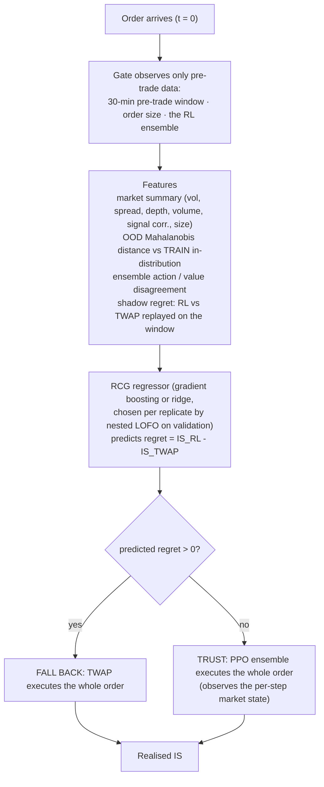
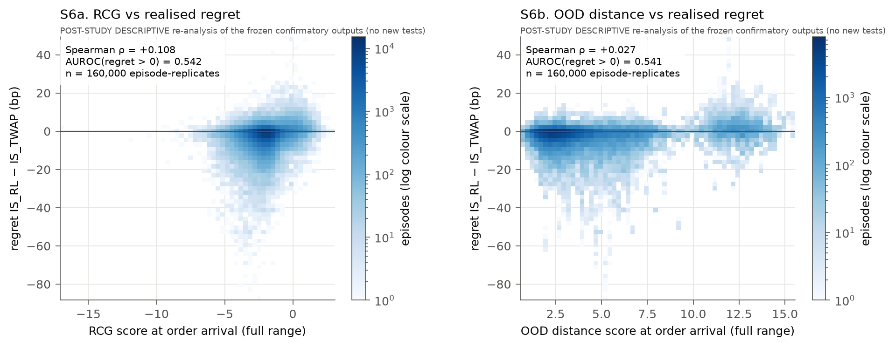
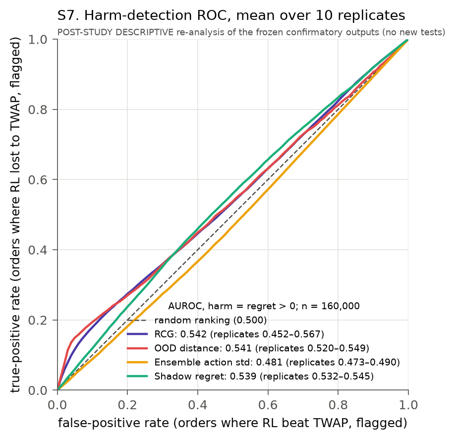
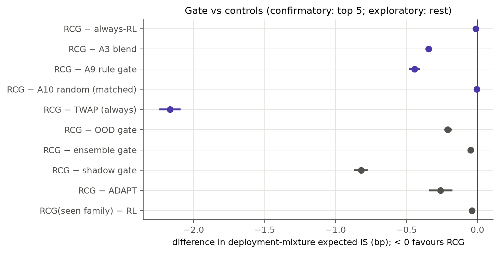
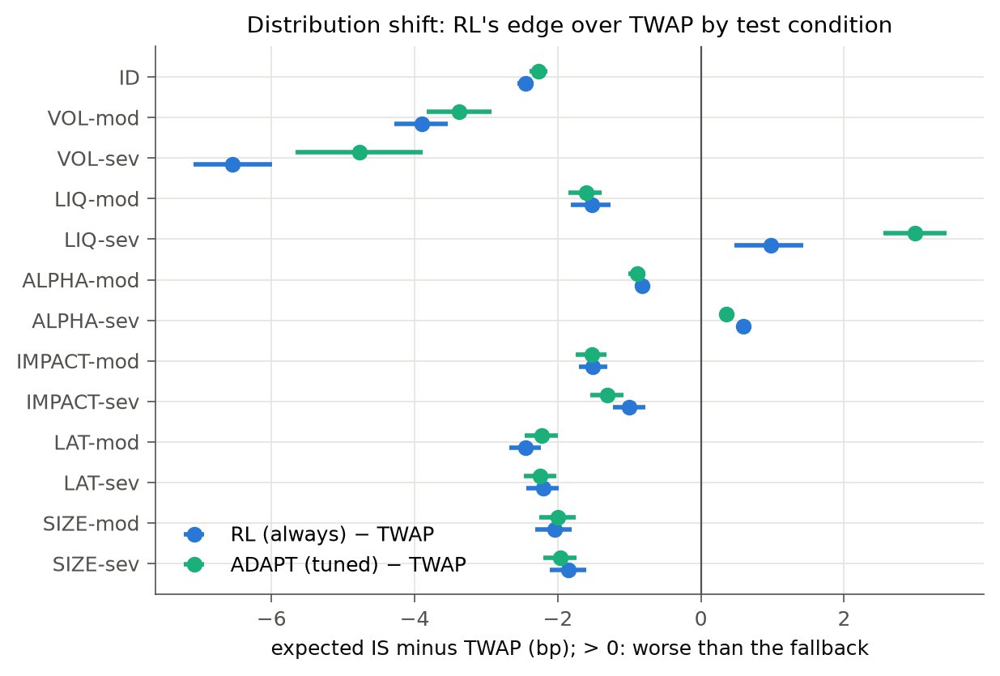
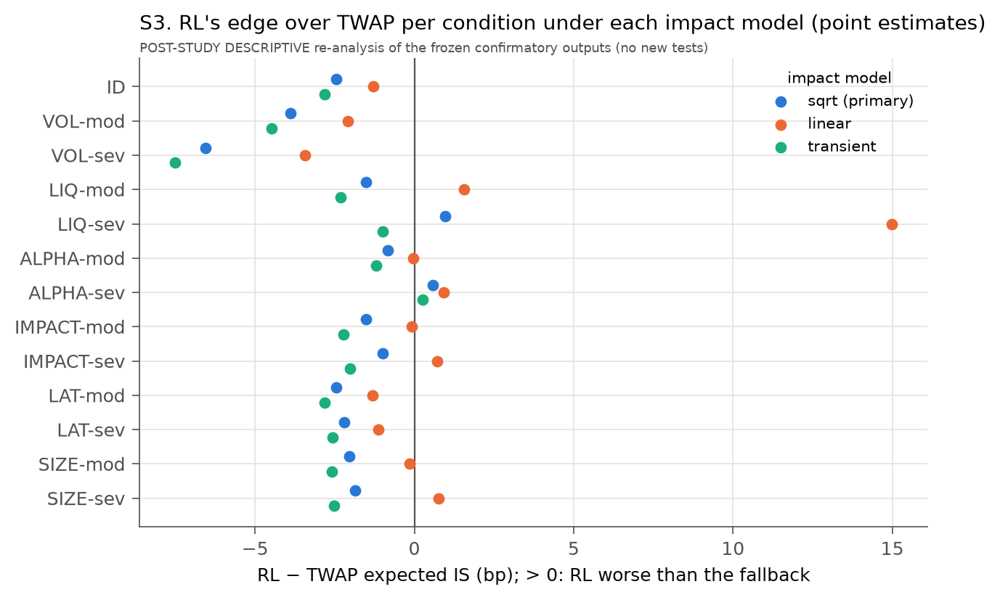

# ExecShift

**A pre-registered study of when a reinforcement-learning trade-execution policy should be
trusted under distribution shift, and when it should fall back to TWAP.**

[](https://github.com/ManasSakthivel/execshift/actions/workflows/ci.yml)


## 1. Key finding

> **This is a negative result.** The study's central claim is that an uncertainty-based gate
> should improve on always trusting RL. That claim was **not supported**. The gate's score
> tracks counterfactual regret only weakly (Spearman **ρ = +0.108**, AUROC **0.542**). The
> gate improves on always-RL by **-0.013 bp** [95% CI -0.024, -0.004], about 20× below the
> pre-registered 0.25 bp threshold. It barely beats random switching with the same fallback
> budget (-0.005 bp).

The reason is quantified rather than speculative. A fallback gate can save at most the
*headroom* RL leaves: the cost it incurs in regimes where it loses to TWAP. Under the primary
impact model that headroom is only 0.065 bp. In addition, the costliest failure, alpha decay,
is invisible to every pre-trade observable.

All market data are **synthetic**. Nothing here is evidence of real-market performance.

## 2. Why the problem matters

Learned execution policies adapt to market state, but a desk cannot deploy one that fails
silently in a regime it never saw. "Fall back when uncertain" is the standard safety pattern.
It rests on an assumption that is rarely tested: that generic uncertainty (ensemble
disagreement, out-of-distribution distance) tracks *harm*. This study tests that assumption
against a pre-registered, practically meaningful threshold. Its controls separate a real
signal from random switching.

## 3. Research question and hypotheses

A desk sells a parent order over 30 minutes and pays **implementation shortfall** (IS, in
basis points against the arrival price). The question is: at order arrival, does uncertainty
predict the **counterfactual regret** `IS_RL - IS_TWAP`, and does acting on it beat simple
controls?

| | Pre-registered hypothesis | Decision rule (SESOI = 0.25 bp) |
|---|---|---|
| H1 | RL beats tuned classical baselines in-distribution | RL - TWAP and RL - AC < -SESOI, Holm-significant |
| H2 | RL's edge degrades under natural shift | ≥ 1 of 12 conditions degrades by > SESOI |
| H3 | The gate's score predicts regret | Spearman ρ CI > 0 and AUROC CI > 0.5 |
| H4 | The gate beats always-RL (**central claim**) | RCG - RL < -SESOI, significant |
| H5 | The gate beats blend, rule, matched-random and always-TWAP controls | all four Holm-significant |
| H6 | Conclusions are robust to impact model and latency | significant comparisons keep sign and significance under linear and transient impact and 0 / 1 / 5 s latency |

## 4. Pre-registration and scope

The protocol ([`research/PREREGISTRATION.md`](research/PREREGISTRATION.md)) and the ten
modules that implement the simulator, policies, gates, statistics and analysis were
hash-locked in [`research/prereg.lock`](research/prereg.lock) **before the test split was
ever generated**. `adexec/guard.py` refuses to create test episodes if any locked byte
changes, and every test-split access is appended to
[`results/test_access_log.jsonl`](results/test_access_log.jsonl). Later work wraps the frozen
core and never edits it. Everything added after the confirmatory run is labelled
**POST-STUDY / EXPLORATORY** or **POST-STUDY DESCRIPTIVE**.

Scope: one parametric synthetic market, marketable orders only, a single go/no-go decision
at order arrival, and TWAP as the only fallback.

## 5. System architecture



Package-level detail and the dependency graph: [`docs/ARCHITECTURE.md`](docs/ARCHITECTURE.md).

## 6. Experimental methodology



- **Market.** Stochastic volatility, Student-t returns, latent alpha with a noisy observable
  signal, spread/depth/volume processes, three impact models, and latency via a Brownian
  bridge ([`docs/SIMULATOR_VALIDATION.md`](docs/SIMULATOR_VALIDATION.md)).
- **Shift suite.** In-distribution plus 12 conditions in 6 families (volatility, liquidity,
  alpha decay, hidden impact, latency, order size), each at moderate and severe levels.
  Gates are scored on a deployment mixture: 50% in-distribution, 50% spread over the shifts.
- **Fair baselines.** TWAP, Almgren-Chriss and the ADAPT heuristic are tuned with the same
  in-distribution information as RL ([`docs/BASELINES.md`](docs/BASELINES.md)).
- **RL.** PPO with a residual action on the TWAP pace. A 16-configuration search runs on
  validation data only, with no best-run selection ([`docs/RL_TRAINING.md`](docs/RL_TRAINING.md)).
- **Statistics.** Common random numbers, a control-variate IS estimator (realised IS as
  sensitivity), crossed bootstrap, Holm correction and effect sizes
  ([`docs/METHODOLOGY.md`](docs/METHODOLOGY.md)).

### The gating decision



The gate decides once per order and never revisits that decision. It never sees latent
simulator state (true alpha, true impact coefficient, regime multipliers). The study computes
gated cost as `where(fallback, IS_TWAP, IS_RL)`; `adexec/agents/gated.py` rolls the gate out
step by step, and a test checks that both give the same cost.

## 7. Main findings

Confirmatory test split: 10 RL replicates × 5-member PPO ensembles × 16,000 episodes, primary
(square-root) impact model. Values are bp of IS with 95% crossed-bootstrap CIs. Full tables:
[`results/tables.md`](results/tables.md).

| | Result | Verdict |
|---|---|---|
| H1 | RL - TWAP = -2.45 [-2.57, -2.34] bp; practically tied with tuned ADAPT (-0.18 bp) | supported |
| H2 | the edge erodes in 8 of 12 conditions; RL loses to TWAP under severe liquidity drought and complete alpha decay | supported |
| H3 | RCG score: ρ = +0.108 [+0.072, +0.138], AUROC 0.542 [0.519, 0.559]; ensemble disagreement ρ = -0.016, OOD distance ρ = +0.027 | supported by the rule, **practically weak** |
| H4 | RCG - always-RL = -0.013 [-0.024, -0.004] bp, below the 0.25 bp threshold | **not supported** |
| H5 | beats blend, rule, matched-random and TWAP under sqrt impact, but beats matched random by only -0.005 [-0.010, -0.001] bp | supported (primary model only) |
| H6 | robust to latency; **not** robust to the impact model | **not supported** |

**Why the negative result is informative.**

1. **A gate is bounded by fallback headroom.** If RL rarely loses to TWAP, even a perfect gate
   gains little. The condition-level oracle headroom is 0.065 bp (sqrt), 0.788 bp (linear)
   and 0.011 bp (transient). The realised gate gains track it: 0.013, 0.608 and 0.000 bp. The
   value of gating depends on the impact model more than on the gate.
2. **Uncertainty catches visible shifts.** In a severe liquidity drought, where spreads and
   depth are observable, the gate falls back on 37% of orders.
3. **Uncertainty misses hidden shifts.** Under complete alpha decay RL loses to TWAP, yet the
   gate falls back on 0.1% of orders. The signal's distribution does not change, so no
   pre-trade observable reveals the shift.
4. **OOD is not regret.** OOD distance fires hardest on volatility shifts, which is exactly
   where RL is strongest.
5. **RL carries more tail risk than a tuned heuristic.** In-distribution CVaR95 is 79.1 bp for
   RL versus 64.9 bp for ADAPT, at a practically tied mean.

## 8. Figures

Every figure is generated from committed result files by the commands in
[Reproduction](#9-reproduction). Figures 1–10 are part of the pre-registered study.
S1–S7 are post-study descriptive re-plots of the same confirmatory outputs and run no new
tests.

**Uncertainty vs counterfactual regret.** Every test episode-replicate (n = 160,000) on
linear axes, with nothing clipped. A weak relationship should look weak.



**Harm-detection ROC.** How well each score ranks orders where RL lost to TWAP. Curves are
mean TPR over the 10 replicates. The AUROCs are recomputed with scikit-learn from the
per-episode outputs, and a test checks that they equal the study's values
(`tests/test_reporting.py`).



**Gate vs always-RL and simple controls.** Differences in deployment-mixture expected IS.
Values below zero favour the gate. The top five rows are confirmatory, the rest exploratory.



**Distribution shift.** RL's and ADAPT's edge over TWAP in each test condition. Values above
zero mean worse than the fallback.



**Impact-model sensitivity (H6).** RL's edge per condition under each impact model.



<details>
<summary>All figures and their data sources</summary>

| Figure | Shows | Data source | Generated by |
|---|---|---|---|
| `figures/fig1`–`fig10` | simulator validation, ID comparison, seed robustness, shift, uncertainty vs regret, calibration, risk-coverage, gate comparison, impact and latency robustness | `results/figure_data.json`, `results/simulator_validation.json` | `make figures` |
| `S1`–`S3` | policy cost by regime, gate fallback rates, impact sensitivity | `results/authoritative.json` | `make supplementary` |
| `S4`–`S7` | tail risk, regret distribution, score vs regret, harm ROC | `results/post_study/supplementary_data.json` (reduced from `results/raw/`) | `make supplementary` |

S1–S7 are written as PNG and as vector PDF.
</details>

## 9. Reproduction

Requirements: Python 3.12, a CPU (no GPU), no network after installation, and no external
data. Every number derives from fixed seeds.

```bash
make install                # .venv from requirements-lock.txt (uses uv if available) + `execshift`
make check                  # ruff + 258 tests, ~20 s
make reproduce-paper-fast   # every stage at toy scale, ~2 min; never touches the test split
make supplementary          # S1–S7 from committed results (S4–S7 recompute only if results/raw exists)
make figures report         # study figures, tables and report from committed results
make reproduce-paper        # full study from scratch: 76.5 min wall on 14 cores (~10 CPU-hours),
                            # then verifies against results/authoritative.reference.json
```

**Smoke test vs full experiment.** `reproduce-paper-fast` runs every stage at toy scale. Its
numbers are not the study's. `reproduce-paper` retrains all 150 PPO members, regenerates
`results/raw/` (about 340 MB, git-ignored) and appends logged accesses to the test-access log.

**Determinism.** On the recorded environment (macOS arm64, Python 3.12.14, the locked
dependencies) a clean-clone full reproduction was byte-identical: 150/150 PPO weights and
`results/authoritative.json`. On other platforms, PyTorch and BLAS floating-point differences
can change PPO weights slightly. The verifier's pre-declared tolerance is
max(0.02 bp, 10% of the CI half-width) with identical decisions. A cross-platform full
reproduction has **not** been performed. PNG bytes can differ across platforms (font
rasterisation). Details: [`docs/REPRODUCIBILITY.md`](docs/REPRODUCIBILITY.md).

Any published number can be traced to its code, data split and seeds:

```bash
execshift inspect --claim H4    # value, JSON pointer, generating function, decision rule, commit
execshift inspect --study       # lock status, frozen-file hashes, seeds
```

Post-study benchmarks run on a separate episode stream:
`execshift benchmark --list` ([`docs/BENCHMARKS.md`](docs/BENCHMARKS.md)).

## 10. Repository structure

```
adexec/            Python package
  config.py sim.py policies.py rl.py features.py gates.py stats.py analysis.py tuning.py
                   ← frozen, hash-locked study core
  guard.py paths.py interfaces.py
  market/ agents/ uncertainty/ evaluation/ benchmarks/ experiments/ pipeline/ reporting/ cli/
                   ← post-study platform that wraps the core
research/          pre-registration + lock
configs/           machine-readable study design; example experiment configs (TOML)
scripts/           thin stage entry points cited by the frozen documents
results/           authoritative results, reference copy, tables, manifests, test-access log;
                   post_study/ (descriptive reductions)
figures/           study figures 1–10; supplementary/ S1–S7
docs/              methodology, architecture, reproducibility, benchmarks, limitations,
                   literature review, final research report
tests/             258 tests: unit, integration, CLI, integrity, regression
```

## 11. Limitations and threats to validity

- **Synthetic data only.** There is one parametric market and no real limit-order-book
  validation.
- **The conclusions depend on the impact model** (H6 failed). The gate helps materially only
  under linear impact, and there a simple rule gate does as well.
- **The design is narrow.** Marketable orders only, arrival-only gating, TWAP as the only
  fallback, and a risk-neutral objective.
- **RL's bounded residual action space** ([¼, 4] × TWAP pace) may itself limit how badly RL
  can lose, and so shrink the headroom. It was not ablated.
- **Two documentation defects in frozen files** were found by audit. They are recorded, not
  edited.

Full list: [`docs/LIMITATIONS.md`](docs/LIMITATIONS.md). Untested directions:
[`docs/FUTURE_WORK.md`](docs/FUTURE_WORK.md). Full write-up:
[`docs/FINAL_RESEARCH_REPORT.md`](docs/FINAL_RESEARCH_REPORT.md). Novelty audit:
[`NOVELTY_STATEMENT.md`](NOVELTY_STATEMENT.md). The gating *method* is established. The
contribution is the empirical answer and the benchmark.

## 12. License, citation and provenance

The code is MIT-licensed ([`LICENSE`](LICENSE)). Citation metadata is in
[`CITATION.cff`](CITATION.cff). The work is not peer-reviewed and has no DOI.

This repository began as a local clone of an unlicensed RL *market-making* project
(`Bilal-Aamir-Yousuf/rl-market-maker`). **None of its code is included**: ExecShift is an
independent codebase on an orphan branch ([`PROVENANCE.md`](PROVENANCE.md)). Papers,
libraries and development assistance: [`ATTRIBUTION.md`](ATTRIBUTION.md). Contributing:
[`CONTRIBUTING.md`](CONTRIBUTING.md).
