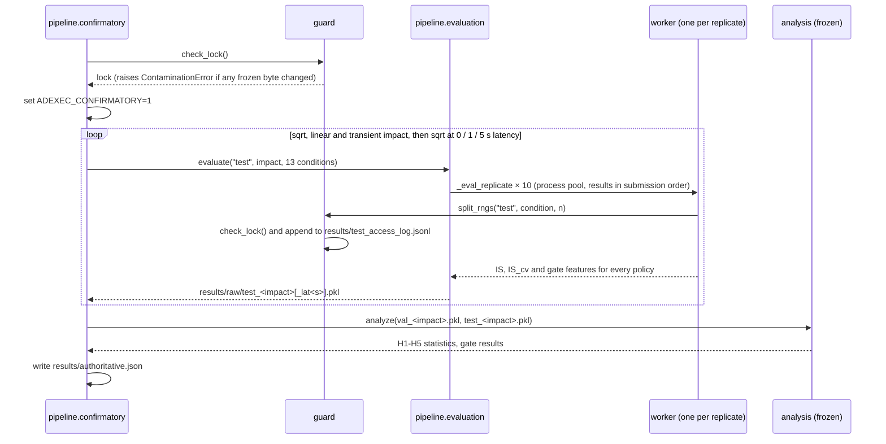

# Architecture

*The "before" picture is [`ARCHITECTURE_AUDIT.md`](ARCHITECTURE_AUDIT.md). This document
describes the platform after the refactor.*

**ExecShift** is the project name. The Python package keeps the name `adexec`: the
pre-registration lock records frozen files as `adexec/<file>.py`, so renaming the package
would change every locked path and count as a protocol deviation.

## 1. The rule that shapes the design

Ten files are hash-locked by `research/prereg.lock`:

```text
research/PREREGISTRATION.md
adexec/config.py  sim.py  policies.py  rl.py  features.py  gates.py  stats.py  analysis.py  tuning.py
```

If any byte of them changes, `guard.check_lock()` refuses to generate test-split episodes.
They hold the simulator, the policies, the PPO set-up, the gate features, the gates, the
statistics and the hypothesis analysis. So:

- **The frozen core sits at the top of `adexec/`, unchanged.**
- **Every platform layer is a subpackage that depends on the core. The core depends on no
  subpackage.** New code wraps frozen code (adapters, delegation) and never re-implements it.
  Tests check that the wrappers agree with the frozen code numerically.

`tests/test_reproducibility.py` pins the lock, the frozen-file list and the SHA-256 of every
historical result artifact.

## 2. Package map

```text
adexec/
├── config.py sim.py policies.py rl.py features.py      FROZEN core (pre-registered study)
│   gates.py stats.py analysis.py tuning.py
├── guard.py         split access + test-set contamination guard + lock check
├── paths.py         single source of truth for repository and artifact locations
├── interfaces.py    typing.Protocols: the platform's extension points
│
├── market/          FrozenSimulator adapter, ImpactModel specs, LatencyModel, Scenario,
│                    post-study seed stream (tag 66), stylised-fact validation
├── agents/          ExecutionPolicy adapters: TWAP, AC, ADAPT, Blend, PPO (ensemble and
│                    single member), GatedPolicy; spec -> policy factory; post-study trainer
├── uncertainty/     UncertaintyEstimator adapters: ensemble disagreement, OOD distance,
│                    shadow regret, RCG predicted regret
├── evaluation/      policy-agnostic rollout engine · metrics engine · statistical layer
├── benchmarks/      declarative BenchmarkSuite · standard catalog · runner + recording
├── experiments/     TOML config + hash · run manifests + FileArtifactStore · study provenance
├── pipeline/        the pre-registered study as importable stages (validate → tune → train →
│                    val → confirm → figures → report → verify; plus the fast pipeline)
├── reporting/       study report renderers · study figures · supplementary figures S1-S7 ·
│                    benchmark figures and reports
└── cli/             `execshift` / `quant-exec`
scripts/             thin entry points (frozen documents cite them); each calls pipeline.<stage>.main
configs/             example experiment configs; machine-readable study design (read-only)
```

## 3. Dependency graph

Arrows point from the importer to the module it imports. There are no cycles.

```text
                       ┌──────────────── frozen core ────────────────┐
                       │ config → sim → policies → rl                 │
                       │            └→ features → gates → analysis ← stats
                       │ guard → tuning                               │
                       └──────────────────────────────────────────────┘
                              ▲ (everything below imports the core; the core imports none of it)
   guard ──► paths
   market ──► core
   agents ──► core (policies, rl), paths, uncertainty (lazily, for gated specs)
   uncertainty ──► core (features, sim, guard for the TRAIN reference split)
   evaluation.engine ──► market ; evaluation.metrics/statistics ──► core.stats, core.analysis.SESOI
   benchmarks ──► agents, evaluation, market, reporting (on record), experiments (on record)
   experiments ──► market, evaluation.metrics (validation), core (study provenance)
   pipeline ──► agents, evaluation, market, core
   reporting ──► core (config), paths ; supplementary ──► core.analysis, pipeline.evaluation
   cli ──► benchmarks, experiments, agents, pipeline, reporting
```

Layering rule: `evaluation` never imports `agents` or `benchmarks`. `benchmarks` never
imports `pipeline`. Only `pipeline/confirmatory.py` and `guard.py` may request the test
split, and `tests/test_integrity.py` enforces this statically over every module in the package.

## 4. Interfaces

All interfaces are `typing.Protocol`s (`adexec/interfaces.py`). Structural typing lets the
frozen classes, which cannot be edited, satisfy them unchanged.

| Protocol | Implementations | Consumed by |
|---|---|---|
| `MarketSimulator` | `market.FrozenSimulator` | evaluation engine, benchmark runner |
| `ImpactModel` | `market.IMPACT_MODELS` (sqrt, linear, transient) | scenarios, tests |
| `LatencyModel` | `market.LatencyModel` | scenarios |
| `ExecutionPolicy` | every class in `agents` | evaluation engine |
| `RLPolicy` | `agents.PPOPolicy` | uncertainty estimators |
| `BaselinePolicy` | `TWAPPolicy`, `ACPolicy`, `ADAPTPolicy` | manifests |
| `UncertaintyEstimator` | `EnsembleDisagreement`, `OODDistance`, `ShadowRegret`, `RCGScore` | `GatedPolicy`, gate suite |
| `EvaluationMetric` | `evaluation.metrics.METRICS` | benchmark runner, reports |
| `Benchmark` | `benchmarks.BenchmarkSuite` | CLI |
| `Experiment` | `experiments.ExperimentConfig` | benchmark runner, registry, CLI |
| `ArtifactStore` | `experiments.registry.FileArtifactStore` | benchmark recording, CLI |

The policy interface is `reset(ex)` plus `act(ex) -> (B,)` sell fractions. A policy may read
only observable state (`ex.obs()`, `ex.q`, `ex.t`). Hooks for online learning were left out
on purpose: every policy here is frozen at evaluation time, and a hook nothing calls would be
decoration. The natural place to add one is mid-order intervention
([`FUTURE_WORK.md`](FUTURE_WORK.md) §2).

**The evaluation engine has no policy-specific logic.** `evaluation/engine.py` and
`benchmarks/runner.py` contain no policy names and no `isinstance` checks. A test checks
both files' string constants. Policies come from specs through `agents.make_policy`.
Optional diagnostics (the gate's `fallback_rate`) are read with `getattr`.

## 5. Data flow

```text
SeedSequence([tag, condition_index, (seed,) episode])
   tags: 11 train · 22 val · 33 TEST (guarded) · 44 RL training · 55 sim validation
         66 post-study benchmarks · RL-training streams ≥ 50,000 for post-study training
        │
        ▼
Scenario(condition, impact, latency, overrides).params() ──► MarketParams
        │
        ▼
FrozenSimulator.generate(params, rngs) ──► Market (exogenous paths; depends on seeds only)
        │                                         └──► every policy sees the same paths (CRN)
        ▼
FrozenSimulator.execution(market) ──► policy.reset / policy.act loop ──► IS, IS_cv, trades
```

Because the exogenous market depends only on the episode seed, paired differences and
per-episode counterfactual regret are exact. Benchmark episodes do not depend on the impact
model or latency, so robustness comparisons across those settings also use common random
numbers.

## 6. Training flow

```text
study (frozen):  pipeline.training ─► rl.train_member(r, j, impact) × 150 ─► models/
                 results/rl_manifest.json (policy.pth SHA-256 per member)
post-study:      execshift train --config X.toml ─► agents.training.train_from_config
                 frozen ExecVecEnv + configurable PPO kwargs, streams ≥ 50,000
                 ─► runs/<id>/models/ + training.json + manifest (weight hashes)
```

## 7. Evaluation flow

```text
study:      pipeline.validation / confirmatory ─► pipeline.evaluation.evaluate
              study_policies() (one declaration of the policy set) ─► evaluation.engine
              + features.gate_features ─► results/raw/{val,test}_*.pkl
            analysis.analyze(val, test) (frozen) ─► results/authoritative.json
post-study: BenchmarkSuite / ExperimentConfig ─► benchmarks.run_suite
              policies built per impact model ─► evaluation.engine ─► metrics + paired stats
              ─► record_run ─► runs/<id>/{manifest,results,episodes.npz,REPORT.md,figures}
```

The study computes gated costs analytically: `where(fallback, IS_FB, IS_RL)`.
`agents.GatedPolicy` rolls the gate out step by step. `tests/test_agents.py` checks that the
two agree, which turns an implicit shortcut into a tested property.

## 8. Artifact flow

```text
results/authoritative.json ─┬─► pipeline.figure_data (+ results/raw) ─► results/figure_data.json
                            ├─► reporting.study_figures ─► figures/fig2..fig10
                            ├─► pipeline.documents ─► docs/FINAL_RESEARCH_REPORT.md, results/tables.md,
                            │                          FINAL_STANFORD_READINESS_REPORT.md, ...
                            └─► reporting.supplementary (+ results/raw, once)
                                   ─► results/post_study/supplementary_data.json ─► figures/supplementary/S1..S7
runs/<id>/results.json ─► reporting.benchmark_figures / benchmark_report
```

Every generated document is checked against its generator, either by tests (the report and
tables) or by CI (`execshift report --study && git diff --exit-code`).

## 9. Paths and global state

`adexec/paths.py` resolves the repository root (`$ADEXEC_ROOT`, then the package parent,
then the working directory's ancestors). Artifact directories (`models_dir()`, `raw_dir()`,
`baselines_dir()`, `runs_dir()`) are functions evaluated at call time. Before the refactor
they were module constants read from environment variables at import time, so import order
decided where artifacts went (audit item D3). The only remaining process-global setting is
`torch.set_num_threads(1)`, required for bit-for-bit determinism and set by every training
and evaluation worker.

## 10. Extending the platform

| To add | Do this | Touches the frozen core? |
|---|---|---|
| a policy | a class with `name`, `reset`, `act`; register a `kind` in `agents/factory.py` | no |
| an uncertainty signal | a class with `name`, `score(market)`; add it to `uncertainty.make_estimator` | no |
| a metric | a function plus a `Metric(...)` entry in `evaluation/metrics.py` | no |
| a scenario | `Scenario(condition, impact, latency, overrides={...})`, or a config `[market]` | no |
| a benchmark suite | a function returning `BenchmarkSuite` in `benchmarks/catalog.py` | no |
| a new simulator | a class satisfying `MarketSimulator`; pass `simulator=` to the runner | no |

Changing the simulator's dynamics, the 12 shift definitions, the gates or the
pre-registered analysis means changing frozen files. That is a new study with a new
pre-registration, not an extension.

## 11. The confirmatory run, step by step

This is the only code path that touches the test split (`adexec/pipeline/confirmatory.py`).



Gate fitting happens inside `analysis` on the validation pickles. The test pickles are used
only to score already-fitted gates.

## 12. Configuration management

There are two kinds of configuration, deliberately kept apart.

- **Study configuration is code.** The 13 conditions, split sizes, seeds, replicate counts,
  impact models and the SESOI live in the frozen `adexec/config.py` and `adexec/analysis.py`.
  They are covered by the lock, so changing one is a protocol deviation, not a settings
  change. `configs/study/preregistered.json` is a machine-readable copy for inspection, and
  a test checks that it agrees with the code. It is not an input.
- **Post-study experiments are TOML** (`configs/examples/*.toml`), parsed and validated by
  `experiments/config.py`. Unknown keys, unknown conditions or impact models, fewer than two
  episodes, a "pre-registered" label, or a practical threshold other than 0.25 bp without a
  `threshold_source` all raise `ConfigError`. Each config gets a content hash, which is
  recorded in the run manifest.

## 13. Failure behaviour

| Situation | Behaviour |
|---|---|
| A frozen file or the pre-registration changed | `guard.check_lock` raises `ContaminationError`. No test episode is generated. |
| Test split requested outside the confirmatory run | `guard.split_rngs` raises `ContaminationError`. A static test also rejects any new module that requests it. |
| Invalid experiment config | `ConfigError` with the offending key and the allowed values. The CLI prints it and exits with status 1. |
| Unknown or ambiguous run id | `RunNotFoundError`, exit status 1 |
| Run directory already exists | `FileExistsError`. Runs are never overwritten. |
| PPO checkpoints missing in a benchmark | the policy is skipped and listed under `skipped` in the results. `--strict` makes this an error. The reference policy is never skipped. |
| `results/raw/` missing for S4-S7 | `make supplementary` draws S1-S3 and prints that S4-S7 were skipped |
| Reproduced results outside tolerance | `execshift reproduce --verify` lists the failures and exits with status 1. `--strict` also fails on any differing numeric leaf. |
| CLI misuse | argparse usage message, exit status 2 |

Stages do not catch exceptions to continue on partial data. A failed stage stops the
pipeline.

## 14. Design decisions and trade-offs

| Decision | Benefit | Cost |
|---|---|---|
| Freeze the study core and wrap it, rather than refactor it | the confirmatory results stay tied to locked, hashed code | the frozen modules keep their original style, are excluded from mypy and formatting, and some logic is reached through adapters |
| Common random numbers: markets depend only on seeds | paired differences and per-episode regret are exact, with no extra simulation | episodes cannot react to the trader beyond the impact model |
| Gated cost computed analytically in the study | one rollout per policy, not per gate | needed a separate step-by-step `GatedPolicy` and a test that the two agree |
| Raw per-episode outputs as git-ignored pickles | fast to write and read | about 340 MB of local state. Pickle is unsafe for untrusted files, so load only files this pipeline produced. |
| Process pools that return in submission order | the output does not depend on the worker count | per-replicate parallelism only |
| Single-threaded torch | bit-for-bit identical PPO weights on one platform | slower training |
