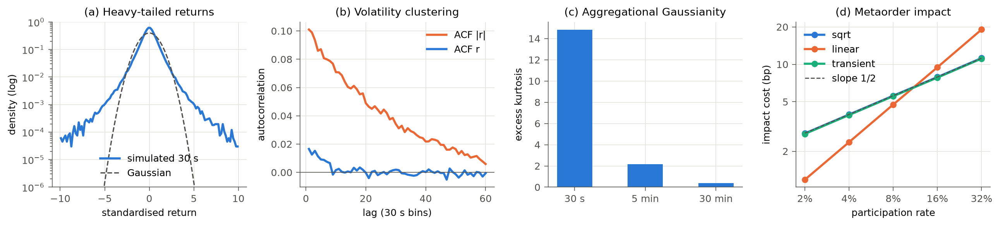
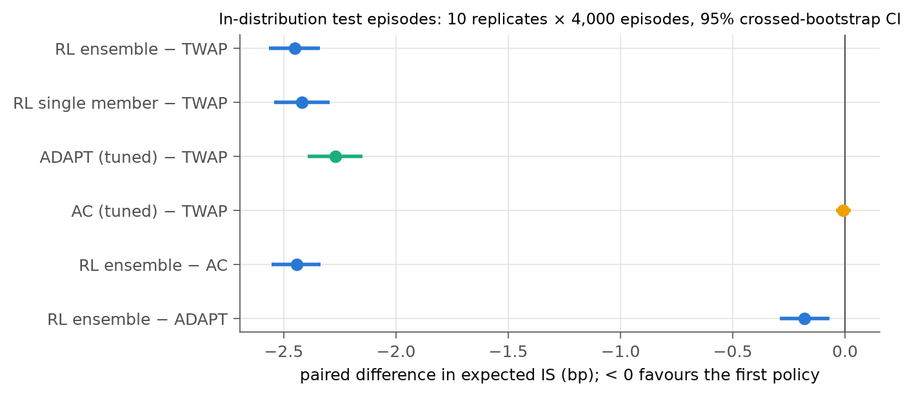
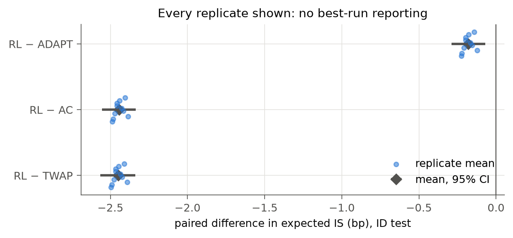
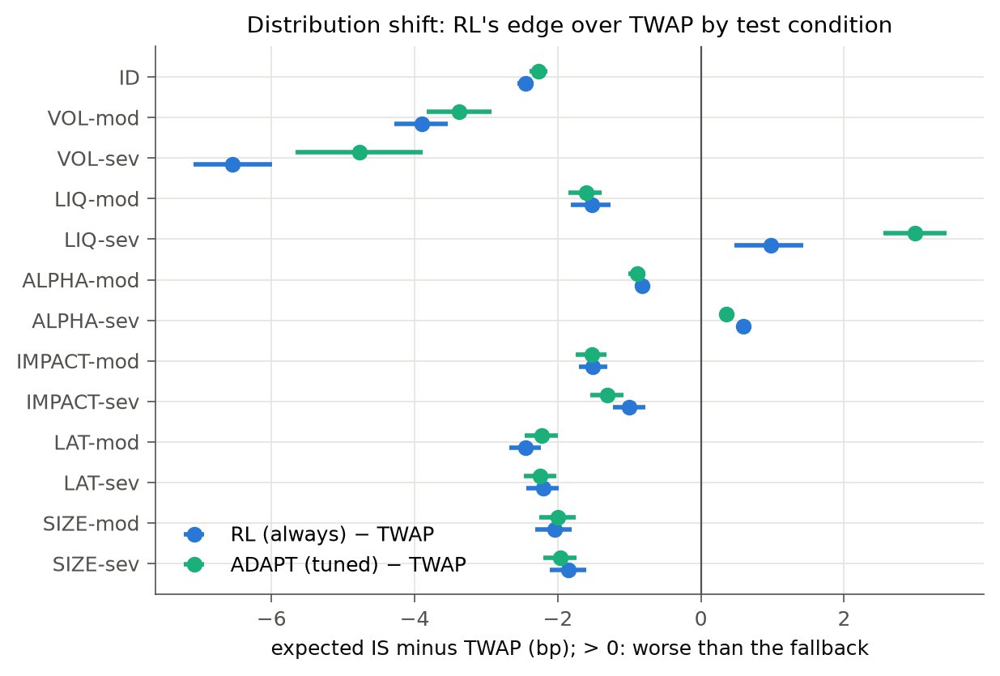
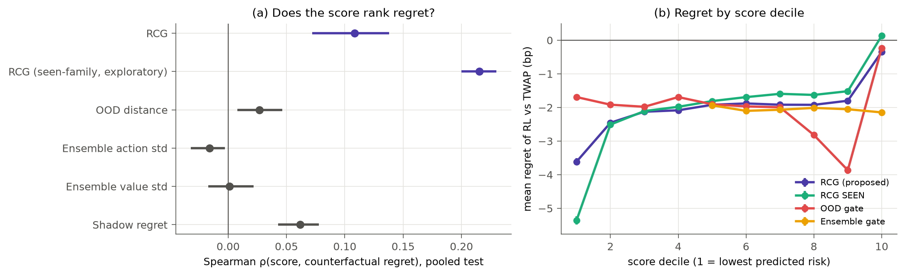
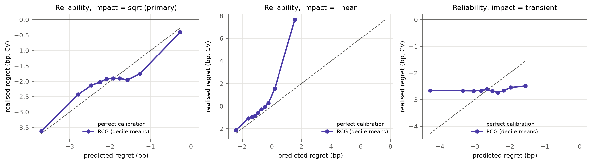
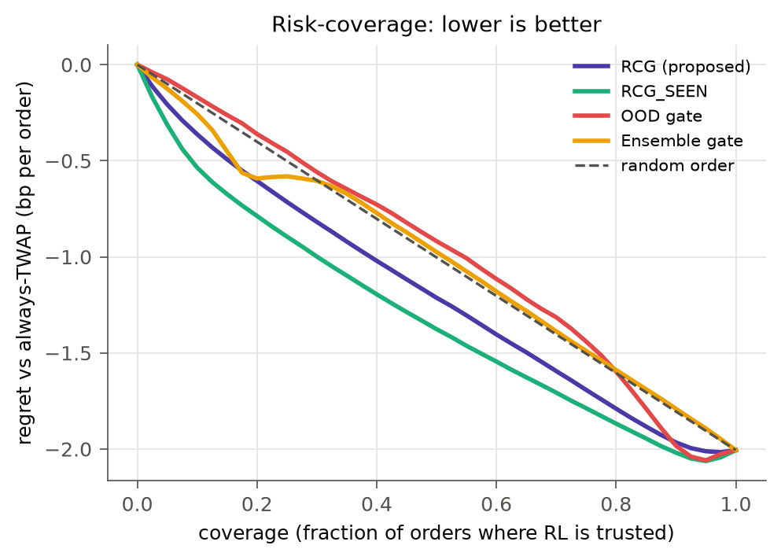
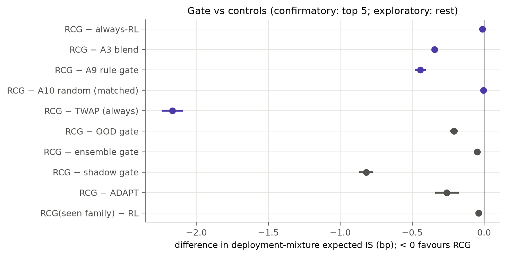
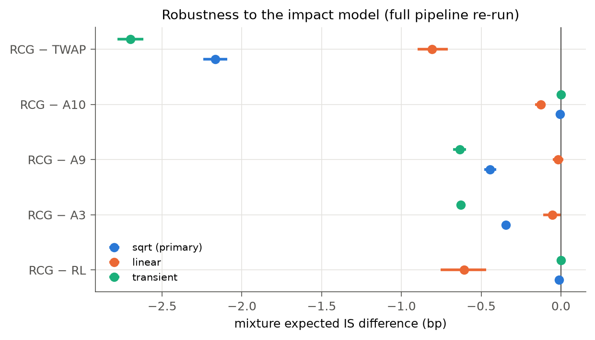
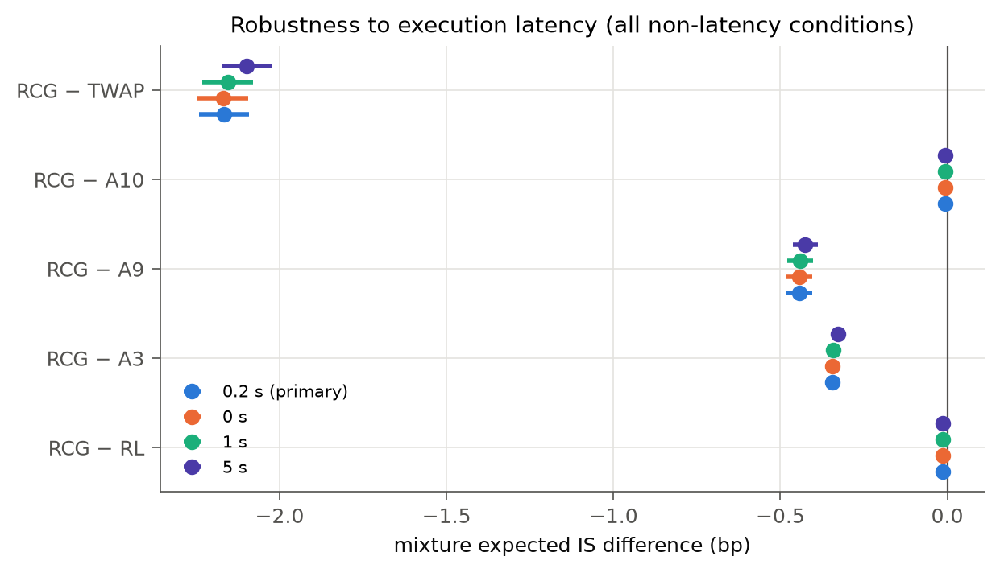

# Regret-calibrated selective intervention for RL trade execution under distribution shift: a pre-registered synthetic-market study

*Generated by `scripts/build_report.py` from `results/authoritative.json` and `results/figure_data.json`. Every number below is inserted programmatically; `tests/test_integrity.py` fails if this file is stale. All market data are **synthetic**.*

## 1. Abstract

**Question.** Can an uncertainty-aware gate decide, at order arrival, when to trust an RL execution policy, and fall back to TWAP when RL's expected regret is positive?

**Design.** A validated synthetic market with three impact models. PPO deep ensembles: 10 replicates × 5 members per impact model, trained in-distribution only. Classical baselines tuned on separate data. Twelve natural shift conditions in six families, frozen before training. Gates fitted leave-one-shift-family-out on validation data. A single confirmatory test run after a hash-locked pre-registration.

**Result 1 (H1: PASS).** In-distribution, RL has lower cost than tuned TWAP (RL − TWAP = -2.45 [-2.57, -2.34] bp, about 35% of TWAP's cost) and than tuned AC (RL − AC = -2.44 [-2.55, -2.34] bp). Every replicate is better than TWAP.

But RL is not practically better than a tuned feature-driven heuristic (ADAPT): RL − ADAPT = -0.18 [-0.29, -0.07] bp with the primary estimator, and +0.10 [-0.16, +0.37] bp with realised IS, below the 0.25 bp threshold of practical interest. RL also carries more tail risk than ADAPT: CVaR95 79.1 vs 64.9 bp.

**Result 2 (H2: PASS).** RL's edge erodes significantly and materially in 8/12 shift conditions. RL is worse than TWAP only in LIQ-sev, ALPHA-sev.

**Result 3 (H3: PASS, practically weak).** The gate's predicted regret ranks realised counterfactual regret only weakly: Spearman ρ = +0.108 [+0.072, +0.138], AUROC 0.542.

Raw uncertainty signals do worse. Ensemble disagreement does not predict regret at all (ρ = -0.016). OOD distance barely does (ρ = +0.027).

**Result 4 (H4: FAIL; H5: PASS).**

- Relative to always-RL, the gate changes mixture cost by only RCG − RL = -0.013 [-0.024, -0.004] bp, which is statistically significant but practically negligible.
- It beats the blend (A3), rule (A9) and always-TWAP controls by material margins.
- It beats random switching with the same fallback budget (A10) by only -0.005 [-0.010, -0.001] bp.

**Result 5 (H6: FAIL).** The gating conclusions do **not** survive a change of impact model:

- Under linear (Almgren-Chriss) impact, RL fails more often. The gate then helps materially (-0.608 [-0.753, -0.468] bp), but a simple rule gate does as well.
- Under transient impact the gate almost never acts (at most 0.6% of orders in any condition), and H3 fails.

Latency changes do not alter any conclusion.

**Conclusion.** In this market, selective intervention is worth only as much as the room RL leaves for it: the cost RL incurs in the regimes where it loses to TWAP.

Measured as a condition-level oracle bound, that room is 0.065, 0.788 and 0.011 bp under the sqrt, linear and transient models. The realised gate gains track it: 0.013, 0.608 and 0.000 bp.

Uncertainty signals detect *visible* (covariate) shifts but not *invisible* (concept) shifts such as alpha decay. The proposed gate is **not** a robust improvement over simple controls. This is a negative result for the method. It is a positive, quantified answer to *when* uncertainty-based fallback can and cannot help.

## 2. Research question

> Can uncertainty-aware selective intervention determine when an RL execution policy should be trusted under distribution shift, and fall back to a robust classical policy when the expected regret of using RL is too high?

**Decision unit:** one 30-minute parent sell order (60 × 30 s decisions).

**Regret:** `IS_RL − IS_TWAP` on the same market, using common random numbers.

**The key test:** does an uncertainty signal tell us *when using RL will cost more than the fallback*? Rising under shift is not enough.

## 3. Literature context

See [`docs/LITERATURE_REVIEW.md`](LITERATURE_REVIEW.md), including its adversarial second pass.

- **RL for execution** beats TWAP/AC in-distribution in many studies (Nevmyvaka et al. 2006; Ning et al. 2021; Lin & Beling 2020; Fang et al. 2021), and is known to overfit (Zhang et al. 2023).
- **Uncertainty-triggered fallback** from RL to a conservative policy is established:
  - Rotman et al. 2020;
  - Neggatu et al., AAMAS 2025;
  - Simplex and Neural Simplex; Recovery RL;
  - in trading, FineFT 2025; in forecast-gated execution, Irshad & Biswas 2026.
- **Cost-sensitive learning to defer** is established (Mozannar & Sontag 2020; Narasimhan et al. 2022).
- **The open question** is empirical: whether uncertainty predicts *regret against the fallback*, on *held-out kinds* of shift, against a *matched random* control.

## 4. Novelty

See [`NOVELTY_STATEMENT.md`](../NOVELTY_STATEMENT.md). The verdicts were written before the results were inspected.

- **Not new:** the gating method (it is learning to defer / uncertainty fallback).
- **Plausibly novel:** the regret-centred empirical question and its answer in execution (C1, C5).
- **Methodological rigor:** the control-variate labels (C2), the leave-one-family-out (LOFO) protocol (C3) and the matched controls (C4).

Given the results, the defensible contribution is a **pre-registered negative/mixed empirical finding with an identified mechanism**, not a new algorithm.

## 5. Hypotheses

Pre-registered in [`research/PREREGISTRATION.md`](../research/PREREGISTRATION.md) and hash-locked in `research/prereg.lock` before any test episode existed. The lock is verified by `adexec/guard.py` and in CI. The verdicts below follow the pre-registered criteria exactly. Statistical and practical significance are reported separately.

| | Hypothesis | Prediction | Test | Result (bp, 95% CI) | Effect size | Statistical evidence | Practical interpretation | Verdict |
|---|---|---|---|---|---|---|---|---|
| H1 | RL beats tuned classical execution in-distribution | RL − TWAP < 0, RL − AC < 0 | crossed bootstrap, Holm(3) | RL−TWAP -2.45 [-2.57, -2.34]; RL−AC -2.44 [-2.55, -2.34]; RL−ADAPT -0.18 [-0.29, -0.07] | d_z = -0.69 | p_Holm < 1e-4; 10/10 replicates | Large and material versus TWAP/AC. Versus ADAPT, significant but below SESOI, and the sign flips with realised IS (+0.10 [-0.16, +0.37]). | **PASS** |
| H2 | RL degrades under realistic shift | D_c > 0.25 in ≥ 1 condition | difference-in-differences, Holm(12) | 8/12 conditions; largest LIQ-sev +3.42 [+2.97, +3.91] | — | p_Holm < 1e-4 (largest) | RL loses to TWAP only in LIQ-sev, ALPHA-sev. Its edge *grows* under volatility shifts. | **PASS** |
| H3 | Score predicts counterfactual regret | ρ > 0 and AUROC > 0.5 | pooled LOFO test, crossed bootstrap | ρ = +0.108 [+0.072, +0.138]; AUROC 0.542 [0.519, 0.559] | ρ ≈ 0.11 | CIs exclude chance | **Weak**: AUROC barely above 0.5; ρ = +0.056 against realised regret; fails under the transient model. | **PASS** |
| H4 | Gate beats always-RL | RCG − RL < −0.25 | crossed bootstrap | -0.013 [-0.024, -0.004] | -0.05 × SESOI | significant (p = 0.0054) | Negligible: about 0.013 bp per order | **FAIL** |
| H5 | Gate beats A3, A9, A10, TWAP | all Δ < 0, Holm(4) | crossed bootstrap | A3 -0.344 [-0.365, -0.323]; A9 -0.443 [-0.481, -0.404]; A10 -0.005 [-0.010, -0.001]; TWAP -2.167 [-2.242, -2.092] | — | all p_Holm < 0.05 | Material against A3, A9 and TWAP. Against the matched random control the margin (-0.005 bp) is practically nil. | **PASS** |
| H6 | Conclusions survive impact and latency changes | same significant signs | full re-run (impact), re-evaluation (latency) | impact: FAIL; latency: PASS | — | see §15 | Gating claims hold only under the primary impact model | **FAIL** |

## 6. Simulator

A new, vectorised synthetic market (`adexec/sim.py`):

- log-AR(1) stochastic volatility with Student-t(4) innovations;
- a latent OU alpha observed through a noisy order-flow signal (R² ≈ 1.3% at 30 s);
- spread, depth and volume state processes coupled to volatility;
- three impact models, all matched in cost at 7.5% participation:
  - **sqrt** (primary): square-root temporary impact plus concave cumulative impact;
  - **linear**: Almgren-Chriss linear temporary and permanent impact;
  - **transient**: a propagator in which half of the temporary impact decays with a 120 s half-life;
- latency via a Brownian bridge inside the bin.

Each episode is generated from three integers, so every policy faces the identical market (common random numbers).

## 7. Simulator validation

**Validation came before any policy result.** 42/42 stylised-fact checks pass across the three impact models. Details: [`docs/SIMULATOR_VALIDATION.md`](SIMULATOR_VALIDATION.md).

The checks cover heavy tails, aggregational Gaussianity, absence of linear autocorrelation, volatility clustering, volume-volatility and spread-volatility correlations, liquidity variation, signal R², square-root-law concavity and the impact prefactor.

One check initially **failed**: impact concavity, with a slope of 0.87 under linear permanent impact. The cause was diagnosed and fixed before any policy was trained.

Not modelled: intraday seasonality, the leverage effect, long memory of volatility, queue dynamics and limit-order fills.

## 8. Experimental design

**Splits.** Disjoint seed streams for train, validation, test, RL training and simulator validation.

| Split | In-distribution episodes | Episodes per shift condition |
|---|---|---|
| Train | 4,000 | — |
| Validation | 2,000 | 500 |
| Test | 4,000 | 1,000 |

**Test access.** The test split was materialised only by the confirmatory script, after the lock. It was accessed 780 times, all logged after the lock: 6 configurations × 10 replicates × 13 conditions.

**Shift suite.**

| Shift | Moderate | Severe |
|---|---|---|
| VOL (volatility) | σ × 1.75 | σ × 3 |
| LIQ (liquidity drought) | spread × 2, impact × 1.5, visible depth / 1.5, volume × 0.7 | spread × 4, impact × 2.5, depth / 2.5, volume × 0.5 |
| ALPHA (signal decay) | loading × 0.5 | loading × 0 |
| IMPACT (hidden) | × 2 | × 3 |
| LATENCY | 2 s | 10 s |
| SIZE (order size) | × 2 | × 3 |

**Deployment mixture:** 50% in-distribution, plus 50% spread evenly over the 12 shift conditions.

**Gates.** Fitted on validation data only, leaving out the test condition's shift family (LOFO).

## 9. Baselines

[`docs/BASELINES.md`](BASELINES.md) lists ranges, budgets and tuned values.

- **TWAP:** the fallback.
- **AC:** κ grid; practically identical to TWAP under the risk-neutral endpoint, as theory predicts.
- **ADAPT:** five-weight feature-driven heuristic, ≤ 361 evaluations.
- **Fair information:** baselines were tuned only on in-distribution train episodes, the same information RL had. Controls A3 and A9 were tuned on validation data, with the same LOFO protocol as RCG.

## 10. RL training

[`docs/RL_TRAINING.md`](RL_TRAINING.md) has the full details.

- **Algorithm:** PPO (Stable-Baselines3).
- **Action:** a residual multiplier on the remaining-TWAP pace, in [¼, 4].
- **Reward:** mark-to-market reward with a training-only control-variate denoising.
- **Hyperparameters:** 16 configurations, selected on in-distribution validation episodes.
- **Scale:** 150 members, 20M steps each. The final checkpoint is used; there is no best-run selection.

## 11. In-distribution results (H1)

| Policy | Mean IS (primary) | Mean IS (realised) | SD | CVaR95 |
|---|---|---|---|---|
| RL ensemble | 4.577 | 5.770 | 33.10 | 79.08 |
| RL single member | 4.608 | 5.804 | 33.00 | 79.06 |
| ADAPT | 4.758 | 5.669 | 27.02 | 64.86 |
| AC | 7.020 | 7.937 | 31.93 | 83.46 |
| TWAP | 7.027 | 7.885 | 30.20 | 79.40 |

- RL − TWAP -2.45 [-2.57, -2.34] bp, with all 10 of 10 replicates negative. Per-replicate values are in `results/tables.md`, T4.
- RL − ADAPT -0.18 [-0.29, -0.07] bp (primary) and +0.10 [-0.16, +0.37] bp (realised). **RL and a tuned heuristic with the same inputs are practically tied.**
- RL bears more tail risk: SD 33.1 vs 27.0 bp.

## 12. Distribution shift (H2)

The degradation D_c (the change in RL − TWAP relative to in-distribution) is significant and > 0.25 bp in 8/12 conditions (table T5).

- **RL becomes worse than TWAP** only in LIQ-sev, ALPHA-sev.
- **Volatility shifts *increase* RL's edge.** The signal's value scales with σ.
- **Latency shifts have no effect** at these magnitudes.

This is the first structural fact behind the later results: under the primary impact model, RL is robust to most natural shifts.

## 13. Uncertainty-regret analysis (H3, the critical test of C1)

| Score | Spearman ρ | AUROC (regret > 0) |
|---|---|---|
| RCG predicted regret (LOFO) | +0.108 | 0.542 |
| RCG, seen-family (exploratory) | +0.215 | 0.598 |
| Mahalanobis OOD distance | +0.027 | 0.541 |
| Ensemble action disagreement | -0.016 | 0.481 |
| Ensemble value disagreement | +0.001 | — |

Full table with CIs, AUROC for top-decile regret and AUPRC: `results/tables.md`, T6.

**Within-condition ranking** is weak everywhere: the largest within-condition ρ is +0.103 (T7).

**Harm detection** (base rate of harmful episodes: 30.1%):

| Gate | Precision | Recall |
|---|---|---|
| RCG | 52.0% | 6.1% |
| A9 rule | 34.8% | 35.0% |
| OOD | 40.8% | 22.6% |
| Ensemble | 27.1% | 1.6% |

**Calibration.** Predicted regret is compressed and only partly aligned with realised regret (fig. 6). The top decile is where most of the signal sits.

**Answer to the key question.** Does uncertainty tell us *when using RL will cost more than TWAP*?

- *Policy* uncertainty (ensemble disagreement): **no**.
- *OOD* distance: **essentially no**. It flags volatility shifts, where RL is at its best.
- A regressor trained to predict regret: **weakly**, and only for visible shifts.

## 14. Selective intervention (H4, H5)

Deployment-mixture statistics. The mean uses the primary (CV) estimator; the median and SD use realised IS.

| Policy | Mean IS (primary) | Median (realised) | SD (realised) | Regret vs TWAP | Fallback rate |
|---|---|---|---|---|---|
| Always RL | 6.332 | 7.44 | 39.54 | -2.154 | — |
| Always TWAP | 8.486 | 7.66 | 36.00 | +0.000 | 100% |
| Always AC | 8.491 | 7.68 | 38.03 | +0.004 | — |
| OOD-only gate | 6.528 | 7.48 | 38.73 | -1.958 | 11.4% |
| Ensemble-only gate | 6.368 | 7.43 | 39.48 | -2.118 | 1.6% |
| A9 rule gate | 6.762 | 7.48 | 38.21 | -1.724 | 21.8% |
| A3 blend | 6.663 | 7.28 | 38.21 | -1.823 | — |
| A10 random (matched) | 6.324 | 7.45 | 39.40 | -2.162 | — |
| **RCG (proposed)** | 6.319 | 7.44 | 39.42 | -2.167 | 2.1% |
| Always ADAPT (reference) | 6.578 | 7.16 | 31.75 | -1.908 | — |
| RCG seen-family (exploratory) | 6.293 | 7.43 | 39.31 | -2.194 | 3.6% |
| Oracle (unachievable) | 6.022 | 7.29 | 38.61 | -2.465 | — |

**Pre-registered comparisons** (Holm-corrected; T8):

- RCG − always-RL: -0.013 [-0.024, -0.004] bp
- RCG − A3: -0.344 [-0.365, -0.323] bp
- RCG − A9: -0.443 [-0.481, -0.404] bp
- RCG − A10: -0.005 [-0.010, -0.001] bp
- RCG − TWAP: -2.167 [-2.242, -2.092] bp

RCG's fallbacks concentrate where they should: LIQ-mod 13.4% and LIQ-sev 36.8%, against 0.0% in-distribution. They are absent where they are needed but the shift is invisible: ALPHA-sev 0.1%.

The OOD-only gate shows the opposite failure. It falls back in 58.6% of VOL-sev orders, where RL is 6.55 bp better than TWAP. Its VOL-sev cost rises from 10.46 to 14.11 bp.

## 15. Robustness (H6)

| Impact model | RL − TWAP (ID) | RL worse than TWAP in | H3 ρ [CI] | H4: RCG − RL | H5 |
|---|---|---|---|---|---|
| sqrt | -2.45 [-2.57, -2.34] | LIQ-sev, ALPHA-sev | +0.108 [+0.072, +0.138] | -0.013 [-0.024, -0.004] | supported |
| linear | -1.29 [-1.39, -1.18] | LIQ-mod, LIQ-sev, ALPHA-sev, IMPACT-sev, SIZE-sev | +0.328 [+0.307, +0.347] | -0.608 [-0.753, -0.468] | not supported; beats A10_RAND, FB |
| transient | -2.82 [-2.94, -2.70] | ALPHA-sev | -0.013 [-0.041, +0.018] | +0.000 [-0.000, +0.001] | not supported; beats A3_BLEND, A9_RULE, FB |

**Latency** (sqrt model; non-latency conditions re-evaluated at 0, 1 and 5 s):

| Latency | H4: RCG − RL | H5 |
|---|---|---|
| 0 s | -0.013 [-0.024, -0.004] | supported |
| 1 s | -0.013 [-0.024, -0.004] | supported |
| 5 s | -0.014 [-0.025, -0.005] | supported |

| Dimension | Classification | Evidence |
|---|---|---|
| Impact model: H1 (RL beats TWAP) | **ROBUST** | Significant under all three models |
| Impact model: H2 (degradation) | **ROBUST** | Supported under all three |
| Impact model: H3 (score predicts regret) | **SENSITIVE / FAILS** | Stronger under linear; fails under transient |
| Impact model: H4 (gate beats RL) | **SENSITIVE** | Material only under linear |
| Impact model: H5 (gate beats controls) | **FAILS** | Holds only under sqrt; under linear the rule gate (A9) ties it; under transient random switching (A10) ties it |
| Latency (0-10 s) | **ROBUST** | No conclusion changes |
| Volatility, liquidity, alpha, impact, size families | **SENSITIVE** | See T11. The gate helps only in the liquidity family, where the blend (A3) is better still; it is inert elsewhere |
| Execution horizon | **NOT TESTED** | The horizon is fixed at 30 min; only order size (SIZE) varies relative participation |

## 16. Ablations

All ablations below are exploratory and labelled as such in T8.

- **Uncertainty-only gates.** OOD gate: RCG − OOD = -0.209 [-0.237, -0.182] bp. Ensemble gate: RCG − ensemble = -0.049 [-0.060, -0.038] bp. Thresholding raw uncertainty is worse than regret-calibration, mainly because it falls back where RL is strong.
- **Shadow-regret gate:** RCG − shadow = -0.820 [-0.868, -0.773] bp. It replays the pre-trade window, and its single-path signal is noise-dominated.
- **Seen-family RCG** (fitted with the test family's validation data): ρ = +0.215 vs +0.108 for LOFO, and a mixture gain over RL of -0.039 [-0.057, -0.023] bp. Experience with the *kind* of shift roughly doubles the ranking signal, but the gain stays far below the 0.25 bp threshold.
- **Oracle:** RCG − oracle = +0.297 [+0.266, +0.327] bp. This per-episode oracle uses future information and is not achievable.
- **Single PPO member vs 5-member ensemble:** RL1 − TWAP = -2.42 [-2.54, -2.29] bp. Ensembling adds little in-distribution.

## 17. Negative results and their mechanism

Every mechanism below is supported by the measurements cited with it.

**1. Fallback headroom bounds the gate's value.**

- *Headroom* means: falling back in exactly the conditions where RL is worse than TWAP on average.
- Headroom: sqrt 0.065 bp, linear 0.788 bp, transient 0.011 bp.
- Realised RCG gains: 0.013, 0.608 and 0.000 bp.
- Under sqrt and transient impact, RL beats TWAP in almost every condition. H4 cannot reach the 0.25 bp threshold even with perfect condition-level gating.
- **The pre-registered H4 failure is structural, not a tuning failure.**

**2. Covariate shift is partly detectable; concept shift is not.**

- RCG falls back in 36.8% of LIQ-sev orders (visible spreads and depth) and in 0.1% of ALPHA-sev orders. RL loses to TWAP in both.
- Even with the alpha-decay family in its training data, the seen-family gate falls back in only 0.2% of ALPHA-sev orders.
- The signal's marginal distribution is unchanged by alpha decay, so no pre-trade observable can reveal it within a 30-minute window.

**3. OOD is not regret.**

- OOD distance correlates with regret at ρ = +0.027.
- The largest OOD scores occur under volatility shifts, where RL's advantage is largest.

**4. Policy epistemic uncertainty is uninformative about regret.**

- Ensemble action std ρ = -0.016 under sqrt, with the same sign under all impact models (`results/authoritative.json`).
- This replicates Rotman et al.'s observation that action-based uncertainty is a weak signal, here in execution.

**5. Regret is dominated by future randomness.**

- Against realised regret, ρ halves (from +0.108 to +0.056).
- The control variate removes a 4.1×-99× share of paired-difference variance (§18). Most realised regret is price noise that no decision-time signal can predict.

**Other negative results**

- RL does not practically beat a tuned heuristic with the same inputs (ADAPT).
- RL carries higher tail risk than ADAPT.
- Tuned AC adds nothing over TWAP under a risk-neutral endpoint.

## 18. Statistical analysis

**Units.** RL training replicates (10) are crossed with independent test episodes (4,000 in-distribution; 1,000 per shift). Paired comparisons are made within episode. Steps are never treated as units.

**Intervals.** Two-way crossed bootstrap (B = 10,000), resampling replicates and episodes independently. Mixture weights are fixed. Holm correction is applied within each hypothesis family.

**Effect sizes.** d_z, plus a pre-registered SESOI of 0.25 bp. Secondary: a Wilcoxon test across replicate means.

**Control-variate estimator (C2 audit).**

*Construction and unbiasedness.* The estimator subtracts

    M = Σ_t [ q_{t+1} · F_t σ_t √(1−β²) · ε_{t+1} · (1 − I_{t+1}) + v_t · F_t σ_t √(1−β²) · ξ_t · (1 − I_t)(1 − s_t − τ_t) ]

from the realised P&L. Here ξ_t is the latency-bridge innovation, I the impact state, s the half-spread and τ the temporary impact.

Every factor multiplying ε_{t+1} or ξ_t is fixed by the end of decision t. The innovations are drawn independently of the past, with mean zero, so E[M] = 0 by the tower property, and E[IS_cv] = E[IS].

*Assumptions.* (i) The innovations are mean-zero and independent of all decision-time information. (ii) The impact state after decision t does not depend on ε_{t+1}. Both hold by construction in the simulator.

They do **not** hold verifiably in real markets: the innovations are unobservable, and impact may respond to them. The estimator is therefore a *simulation* device. It is never used on real data, and never used as a policy or gate input.

*Empirical unbiasedness.* Across 39 condition × policy tests of E[IS − IS_cv] = 0, 3 have |z| > 1.96 (about 2.0 expected by chance). The maximum |z| is 2.51, below the Bonferroni threshold of about 3.2.

*Variance reduction.* Paired-difference variance (RL − TWAP) falls by a factor of 4.1-99 per condition (median 4.9×; bootstrap CIs in `results/figure_data.json`). The extreme values occur under alpha decay, where RL − TWAP is almost pure noise.

Realised-IS CIs are a median 2.2× wider than CV CIs across the primary comparisons. Every comparison is reported with both estimators. No decision flips sign at the significance level, **except RL − ADAPT**, which is significant only with the CV estimator. We treat that comparison as a practical tie.

**Test-set independence.** The test split was accessed only after the lock (log: `results/test_access_log.jsonl`), and the frozen code hashes still match. All hyperparameters, thresholds and gate fits used train or validation data only. `tests/test_integrity.py` enforces this.

## 19. Limitations

**The market.**

- All data are **synthetic**. Nothing here is evidence about live trading, profitability or deployability.
- No simulator or replay can show how real participants would have reacted to our orders.
- Impact is parametric, and the conclusions are **impact-model dependent** (§15).
- A single generic venue and asset class (liquid-equity-like parameters), with no calibration to a particular instrument or sample period.

**Execution assumptions.**

- Marketable orders only: no limit-order placement, queueing or tick size.
- No fees (a constant per-share fee would not change comparisons).
- Latency enters only as a fill delay.

**The signal.** The alpha signal is an assumed stylised order-flow predictor, and RL's in-distribution edge depends on it.

**The design.**

- The gate decides once, at arrival. Mid-order intervention was not studied.
- The fallback is TWAP. A feature-driven fallback (ADAPT) was not studied as a fallback.
- RL's bounded residual action space ([¼, 4] × TWAP pace) may itself limit how badly RL can lose. This plausibly contributes to the small headroom, and was not ablated.

**Search budgets and replicates.**

- Hyperparameter budgets: 16 PPO configurations; ≤ 361 ADAPT evaluations; 25 AC values.
- 10 replicates per impact model. Replicate variance is small relative to the effects (T4), but between-replicate variability of the gate itself is bounded only by this sample.

**Analysis choices made during development.** These were made on validation data, before the lock, and are disclosed in the pre-registration, §10: the control-variate estimator, the RCG model-class selection, and the seen-family analysis.

## 20. Reproducibility

- `make reproduce-paper`: the full pipeline from a clean clone (environment → simulator validation → baselines → 150 PPO members → validation → confirmatory test → statistics → figures → report → verification against `results/authoritative.reference.json`).
- `make reproduce-paper-fast`: a reduced sanity pipeline (about 2 min on 14 cores) that never touches the test split.
- Versions are pinned in `requirements-lock.txt`. Checkpoint hashes are in `results/rl_manifest.json`.
- Tolerances are documented in `scripts/verify_reproduction.py`. The status of the clean-clone reproduction is recorded in `FINAL_STANFORD_READINESS_REPORT.md`.

## 21. Conclusion

**RL wins in-distribution.** In this validated synthetic market, a PPO ensemble has lower implementation shortfall than tuned TWAP/AC (RL − TWAP = -2.45 [-2.57, -2.34] bp). A tuned heuristic with the same features does practically as well.

**RL's advantage erodes under shift, and mostly survives.** It turns into a loss only under severe liquidity drought and complete alpha decay.

**The gate does not work in a useful sense.**

- Uncertainty-aware selective intervention, implemented as a regret-calibrated gate, predicts regret only weakly (AUROC 0.542).
- It saves 0.013 bp per order relative to always trusting RL.
- It is not practically better than random fallback at the same rate.
- Its advantages over controls depend on the impact model.

The pre-registered claim that the gate *determines when RL should be trusted* is therefore **not supported**.

**What the study does establish**, within its synthetic scope:

1. The value of selective fallback is bounded by, and tracks, the fallback headroom. That depends on the impact model more than on the gate.
2. Policy-ensemble uncertainty and OOD distance do not predict execution regret.
3. Concept shifts that leave observations unchanged, such as alpha decay, are invisible to any pre-trade gate.

A credible next study would need to:

- measure the headroom on real data first;
- use in-episode evidence (mid-order intervention) to catch concept shift;
- pre-register a new test.
