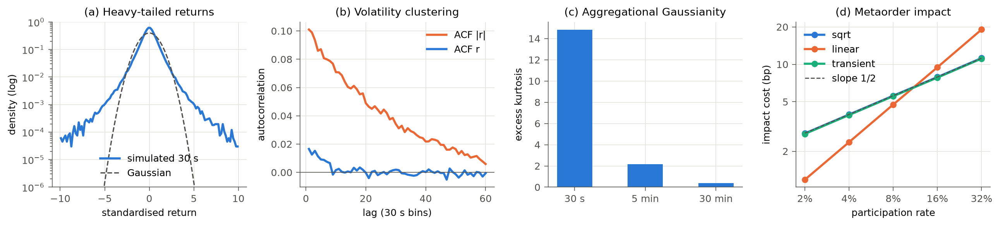

# Simulator validation

*Generated by `scripts/build_report.py` from `results/simulator_validation.json`. Do not edit by hand.*

This validation was run, and its one failure fixed, **before** any policy was trained or evaluated. All market data in this project are **synthetic**. Passing these checks shows that the simulator reproduces a set of well-documented statistical properties of real markets. It does **not** show that results obtained in the simulator transfer to a real market. In particular, no simulator or historical replay can reveal how real participants would have reacted to our orders.

## Nominal parameters and their sources

| Quantity | Value | Empirical anchor |
|---|---|---|
| Decision interval / horizon | 30 s / 60 steps (30 min) | Typical intraday execution slice |
| Per-30 s return vol (median) | 5.5 bp (~24% annualised) | Large-cap equity daily vol 1.5-2% |
| Stochastic vol | log-AR(1), phi=0.97, sd=0.35 | Volatility clustering (Cont 2001) |
| Return innovations | Student-t, 4 d.o.f. | Heavy tails, tail index ~3 |
| Half-spread (median) | 1.5 bp | Quoted spreads of 1-5 bp in liquid large caps |
| Alpha signal | OU, tau=180 s; loading 0.15; corr(signal, alpha)=0.8 | OFI predictive R^2 low single-digit % (Cont et al. 2014; Kolm et al. 2023) |
| Temporary impact | eta*sigma*sqrt(v/V), eta median 0.7 | Square-root law (Almgren et al. 2005; Toth et al. 2011) |
| Cumulative impact | 0.5*sigma*sqrt(executed/bin volume) | Concave metaorder impact (Donier et al. 2015); implied Y ~ 0.7 |
| Order size | 3%-12% of horizon volume | Typical algorithmic participation rates |
| Latency (nominal) | 0.2 s | Cloud-hosted execution (Moallemi & Saglam 2013) |

## Stylised-fact checks

Each check compares a statistic of long simulated series (200 series × 2,000 bins) or of simulated TWAP metaorders against a target range taken from the cited literature. The ranges were set when the checks were written, before the results were seen. The one exception is the impact-concavity check, whose failure is described below.

### Impact model: `sqrt` (14/14 PASS)

| Check | Value | Target | Status | Source |
|---|---|---|---|---|
| Heavy tails: excess kurtosis of 30 s returns | 14.82 | [3, 50] | PASS | Cont (2001) SF-3; intraday excess kurtosis >> 0 |
| Heavy tails: Hill tail index of |r| (top 2%) | 3.292 | [2, 5] | PASS | Gopikrishnan et al. (1999) 'inverse cubic law', alpha ~ 3 (2-5) |
| Aggregational Gaussianity: kurtosis(30 min) / kurtosis(30 s) | 0.0267 | [0, 0.5] | PASS | Cont (2001) SF-4 |
| No linear autocorrelation: max |ACF(r)| at lags 1-60 | 0.0166 | [0, 0.05] | PASS | Cont (2001) SF-1 |
| Volatility clustering: ACF(|r|) at lag 1 | 0.101 | [0.05, 0.5] | PASS | Cont (2001) SF-7 |
| Volatility clustering: ACF(|r|) at lag 20 (10 min) | 0.0489 | [0.02, 0.4] | PASS | Cont (2001) SF-7, slow decay |
| Volume-volatility correlation corr(log V, |r|) | 0.5346 | [0.1, 0.7] | PASS | Cont (2001) SF-10; Karpoff (1987) |
| Spread-volatility correlation corr(log s, log sigma) | 0.6506 | [0.1, 0.9] | PASS | Bouchaud et al. (2018) ch. 12; Wyart et al. (2008) |
| Depth-volatility correlation corr(log depth, log sigma) | -0.5305 | [-0.9, -0.05] | PASS | Bouchaud et al. (2018); liquidity withdraws in volatile periods |
| Liquidity persistence: ACF(log depth) lag 1 | 0.8166 | [0.5, 0.99] | PASS | Liquidity is persistent but mean-reverting (Bouchaud et al. 2018) |
| Liquidity variation: coefficient of variation of depth | 0.4114 | [0.2, 1] | PASS | Intraday depth CV of order 0.3-0.6 in large caps |
| Signal predictive R^2 for next 30 s return | 0.0128 | [0.005, 0.05] | PASS | Cont, Kukanov & Stoikov (2014); Kolm et al. (2023): low single-digit % |
| Impact concavity: log-log slope of cost vs participation [sqrt] | 0.5025 | [0.4, 0.75] | PASS | Almgren et al. (2005) 0.6; Toth et al. (2011) 0.5 (square-root law) |
| Impact level: implied square-root-law prefactor Y at 8% participation | 0.6969 | [0.3, 1.5] | PASS | Toth et al. (2011); Bouchaud et al. (2018): Y ~ 0.5-1 |

### Impact model: `linear` (14/14 PASS)

| Check | Value | Target | Status | Source |
|---|---|---|---|---|
| Heavy tails: excess kurtosis of 30 s returns | 14.82 | [3, 50] | PASS | Cont (2001) SF-3; intraday excess kurtosis >> 0 |
| Heavy tails: Hill tail index of |r| (top 2%) | 3.292 | [2, 5] | PASS | Gopikrishnan et al. (1999) 'inverse cubic law', alpha ~ 3 (2-5) |
| Aggregational Gaussianity: kurtosis(30 min) / kurtosis(30 s) | 0.0267 | [0, 0.5] | PASS | Cont (2001) SF-4 |
| No linear autocorrelation: max |ACF(r)| at lags 1-60 | 0.0166 | [0, 0.05] | PASS | Cont (2001) SF-1 |
| Volatility clustering: ACF(|r|) at lag 1 | 0.101 | [0.05, 0.5] | PASS | Cont (2001) SF-7 |
| Volatility clustering: ACF(|r|) at lag 20 (10 min) | 0.0489 | [0.02, 0.4] | PASS | Cont (2001) SF-7, slow decay |
| Volume-volatility correlation corr(log V, |r|) | 0.5346 | [0.1, 0.7] | PASS | Cont (2001) SF-10; Karpoff (1987) |
| Spread-volatility correlation corr(log s, log sigma) | 0.6506 | [0.1, 0.9] | PASS | Bouchaud et al. (2018) ch. 12; Wyart et al. (2008) |
| Depth-volatility correlation corr(log depth, log sigma) | -0.5305 | [-0.9, -0.05] | PASS | Bouchaud et al. (2018); liquidity withdraws in volatile periods |
| Liquidity persistence: ACF(log depth) lag 1 | 0.8166 | [0.5, 0.99] | PASS | Liquidity is persistent but mean-reverting (Bouchaud et al. 2018) |
| Liquidity variation: coefficient of variation of depth | 0.4114 | [0.2, 1] | PASS | Intraday depth CV of order 0.3-0.6 in large caps |
| Signal predictive R^2 for next 30 s return | 0.0128 | [0.005, 0.05] | PASS | Cont, Kukanov & Stoikov (2014); Kolm et al. (2023): low single-digit % |
| Impact concavity: log-log slope of cost vs participation [linear] | 1.002 | [0.8, 1.1] | PASS | Almgren et al. (2005) 0.6; Toth et al. (2011) 0.5 (square-root law) |
| Impact level: implied square-root-law prefactor Y at 8% participation | 0.5914 | [0.3, 1.5] | PASS | Toth et al. (2011); Bouchaud et al. (2018): Y ~ 0.5-1 |

### Impact model: `transient` (14/14 PASS)

| Check | Value | Target | Status | Source |
|---|---|---|---|---|
| Heavy tails: excess kurtosis of 30 s returns | 14.82 | [3, 50] | PASS | Cont (2001) SF-3; intraday excess kurtosis >> 0 |
| Heavy tails: Hill tail index of |r| (top 2%) | 3.292 | [2, 5] | PASS | Gopikrishnan et al. (1999) 'inverse cubic law', alpha ~ 3 (2-5) |
| Aggregational Gaussianity: kurtosis(30 min) / kurtosis(30 s) | 0.0267 | [0, 0.5] | PASS | Cont (2001) SF-4 |
| No linear autocorrelation: max |ACF(r)| at lags 1-60 | 0.0166 | [0, 0.05] | PASS | Cont (2001) SF-1 |
| Volatility clustering: ACF(|r|) at lag 1 | 0.101 | [0.05, 0.5] | PASS | Cont (2001) SF-7 |
| Volatility clustering: ACF(|r|) at lag 20 (10 min) | 0.0489 | [0.02, 0.4] | PASS | Cont (2001) SF-7, slow decay |
| Volume-volatility correlation corr(log V, |r|) | 0.5346 | [0.1, 0.7] | PASS | Cont (2001) SF-10; Karpoff (1987) |
| Spread-volatility correlation corr(log s, log sigma) | 0.6506 | [0.1, 0.9] | PASS | Bouchaud et al. (2018) ch. 12; Wyart et al. (2008) |
| Depth-volatility correlation corr(log depth, log sigma) | -0.5305 | [-0.9, -0.05] | PASS | Bouchaud et al. (2018); liquidity withdraws in volatile periods |
| Liquidity persistence: ACF(log depth) lag 1 | 0.8166 | [0.5, 0.99] | PASS | Liquidity is persistent but mean-reverting (Bouchaud et al. 2018) |
| Liquidity variation: coefficient of variation of depth | 0.4114 | [0.2, 1] | PASS | Intraday depth CV of order 0.3-0.6 in large caps |
| Signal predictive R^2 for next 30 s return | 0.0128 | [0.005, 0.05] | PASS | Cont, Kukanov & Stoikov (2014); Kolm et al. (2023): low single-digit % |
| Impact concavity: log-log slope of cost vs participation [transient] | 0.5025 | [0.4, 0.75] | PASS | Almgren et al. (2005) 0.6; Toth et al. (2011) 0.5 (square-root law) |
| Impact level: implied square-root-law prefactor Y at 8% participation | 0.6901 | [0.3, 1.5] | PASS | Toth et al. (2011); Bouchaud et al. (2018): Y ~ 0.5-1 |

Excess kurtosis by aggregation horizon (sqrt model): 30 s = 14.82, 5 min = 2.17, 30 min = 0.40.

## A failure we found and fixed

The first version of the simulator used **linear** permanent impact (Almgren-Chriss style) on top of a square-root temporary impact. The metaorder-impact check measured a log-log slope of cost against participation of **0.87**, against an empirical 0.5-0.6.

**Root cause.** The linear permanent component grows in proportion to order size and dominated the total cost.

**Fix.** Following the square-root-law literature (Tóth et al. 2011; Donier et al. 2015), cumulative impact was made concave in executed volume, ∝ σ·√(Q/V). The measured slope then became 0.50, with an implied prefactor Y ≈ 0.7.

A side effect of the fix: total cumulative-impact cost is invariant to the trading schedule. Because the agent may only sell, the round-trip manipulation that Gatheral (2010) rules out for non-decaying nonlinear impact cannot occur. The `linear` model keeps classic linear permanent impact, matched in cost at 7.5% participation.

We also corrected a measurement problem in the check itself. Raw mean IS is dominated by price noise (SD ≈ 30 bp), so the check now measures impact against a zero-impact counterfactual on the same episodes (common random numbers).

## Properties not modelled (claims are limited accordingly)

- Intraday U-shaped volume/volatility seasonality (single 30-min window, no time of day)
- Leverage effect (return-volatility asymmetry)
- Long memory of volatility beyond ~30 min (log-vol is AR(1): exponential, not power-law, decay)
- Discrete tick size, queue dynamics and limit-order fills (execution is by marketable orders against a parametric cost model)
- Reaction of other market participants to our orders beyond the impact model

## Consequences for the claims

- Policy results are conditional on this parametric market and its three impact models. They are evidence about *mechanisms*, such as how uncertainty relates to regret under shift, not about the size of gains on any real venue.
- The alpha signal is a stylised order-flow predictor with R² ≈ 1.3% at 30 s. Its existence and strength are assumptions, and the in-distribution RL edge depends on it.
- Seasonality, the leverage effect and long memory are absent. Strategies that would exploit or suffer from them are not tested.
